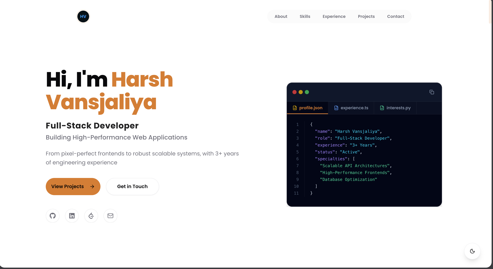

# Harsh Vansjaliya – Portfolio

This repository contains the source code for my personal portfolio. It is a high-performance, SEO-optimized web application built with Next.js 15 (App Router) and Tailwind CSS v4, showcasing my work as a full-stack developer with a growing focus on backend systems and API design.

## 🚀 Overview

The portfolio is designed to be a clean, minimalist reflection of my technical expertise. It features:

- **Dark/Light Mode:** Seamless theme switching using `next-themes`.
- **Dynamic Content:** Showcases real-time data tracking and project progress.
- **Responsive Design:** Mobile-first approach using Tailwind's latest utility engine.
- **SEO Optimized:** Full OpenGraph and Twitter metadata integration for better link previews.

## 🛠️ Tech Stack

### Frontend

- **Framework:** Next.js 15 (App Router)
- **Language:** TypeScript
- **Styling:** Tailwind CSS v4, shadcn/ui
- **Animations:** CSS transitions & `IntersectionObserver`-based scroll reveals

### Backend & Systems

- **Languages:** Node.js, Python (FastAPI/Django)
- **Databases:** PostgreSQL, Redis, MongoDB
- **Tools:** Docker, Git, AWS (EC2/S3)

## 💻 Getting Started

### Prerequisites

- pnpm (recommended) or npm/yarn

### Installation

1. Clone the repository:

```bash
git clone https://github.com/harsh6575/portfolio.git
cd portfolio
```

2. Install dependencies:

```bash
pnpm install
```

3. Run the development server:

```bash
pnpm dev
```

4. Open `http://localhost:3000` to view the result.

## 📈 Optimization & Performance

The site uses modern Next.js features to ensure top-tier performance:

- **Image Optimization:** Automated via next/image.
- **Font Optimization:** Using next/font for Hind & Space Mono.
- **Analytics:** Integrated Vercel Analytics for tracking engagement.

## Screenshots



## 📬 Contact

Email: [harshvansjaliya3@gmail.com](mailto:harshvansjaliya3@gmail.com)
LinkedIn: [harsh-vansjaliya](https://linkedin.com/in/harsh-vansjaliya-904825226/)
Portfolio: [harshvansjaliya.com](https://harshvansjaliya.com)

---

Built with ❤️ by Harsh Vansjaliya
